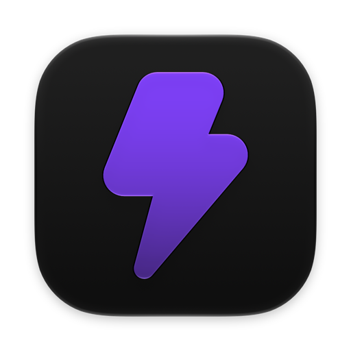
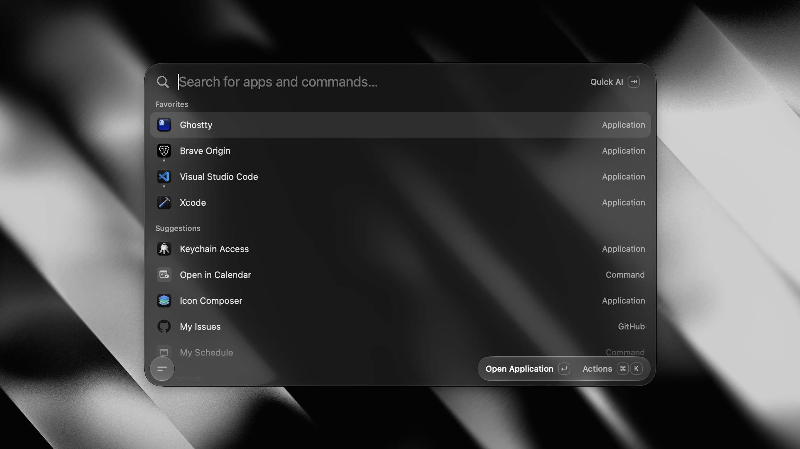

<h1 align="center">
  <a href="https://tinycast.dev"></a><br>
  Tinycast
</h1>

> [!NOTE]
> **This is a modified fork** of [abue-ammar/tinycast](https://github.com/abue-ammar/tinycast),
> maintained by gilitos92 since 2026-10-15 and licensed, like the original, under the
> [AGPL-3.0](LICENSE). See [FORK.md](FORK.md) for what was changed and [CHANGELOG.md](CHANGELOG.md)
> for when. Everything after [Install this fork](#install-this-fork) describes the original project.

## Install this fork

Tinycast needs macOS 26 or later on a Mac with Apple silicon.

1. Download the latest `Tinycast-<version>.dmg` from
   [Releases](https://github.com/gilitos92/tinycast/releases/latest).
2. Open the DMG and drag **Tinycast** into **Applications**.
3. Open Tinycast. macOS says it can't verify the app, because this fork isn't notarized by Apple.
   Click **Done**.
4. Open **System Settings › Privacy & Security**, scroll down to **Security**, and click
   **Open Anyway** next to the message about Tinycast. Confirm with Touch ID or your password, then
   click **Open Anyway** once more.

Instead of steps 3 and 4, you can run this once in Terminal:

```sh
xattr -dr com.apple.quarantine /Applications/Tinycast.app
```

You only do this once. Tinycast then updates itself from this fork's releases.

<p align="center">
  A native macOS launcher for everyday productivity. Lightweight and open source.
</p>

<p align="center">
  <a href="https://tinycast.dev"><strong>Website</strong></a> ·
  <a href="#install"><strong>Install</strong></a> ·
  <a href="https://tinycast.dev/docs/"><strong>Docs</strong></a> ·
  <a href="https://tinycast.dev/support"><strong>Support</strong></a>
</p>

<p align="center">
  <a href="https://github.com/abue-ammar/tinycast/releases/latest"><picture><source media="(prefers-color-scheme: dark)" srcset="https://shieldcn.dev/github/release/abue-ammar/tinycast.svg?variant=ghost&amp;font=geist-mono&amp;mode=dark&amp;label=RELEASE&amp;logo=lu:Tag&amp;valueColor=60A5FA" /></picture></a>
  <a href="https://github.com/abue-ammar/tinycast/releases"><picture><source media="(prefers-color-scheme: dark)" srcset="https://shieldcn.dev/github/downloads/abue-ammar/tinycast.svg?variant=ghost&amp;font=geist-mono&amp;mode=dark&amp;label=DOWNLOADS&amp;logo=lu:CloudDownload&amp;valueColor=A78BFA" /></picture></a>
  <a href="https://github.com/abue-ammar/tinycast/actions/workflows/release.yml"><picture><source media="(prefers-color-scheme: dark)" srcset="https://shieldcn.dev/github/ci/abue-ammar/tinycast.svg?variant=ghost&amp;font=geist-mono&amp;mode=dark&amp;workflow=release.yml&amp;label=BUILD&amp;logo=lu:Hammer&amp;valueColor=4ADE80" /></picture></a>
  <a href="https://discord.gg/v2Eeb4QQy3"><picture><source media="(prefers-color-scheme: dark)" srcset="https://shieldcn.dev/badge/DISCORD-JOIN.svg?variant=ghost&amp;font=geist-mono&amp;mode=dark&amp;logo=discord&amp;valueColor=A5B4FC" /></picture></a>
  <br>
  <picture><source media="(prefers-color-scheme: dark)" srcset="https://shieldcn.dev/badge/MACOS-26%2B.svg?variant=ghost&amp;font=geist-mono&amp;mode=dark&amp;logo=apple" /></picture>
  <picture><source media="(prefers-color-scheme: dark)" srcset="https://shieldcn.dev/badge/SWIFT-6.svg?variant=ghost&amp;font=geist-mono&amp;mode=dark&amp;logo=swift&amp;valueColor=FB923C" /></picture>
  <a href="LICENSE"><picture><source media="(prefers-color-scheme: dark)" srcset="https://shieldcn.dev/badge/LICENSE-AGPL--3.0.svg?variant=ghost&amp;font=geist-mono&amp;mode=dark&amp;logo=lu:Scale" /></picture></a>
</p>

<p align="center">
  
</p>

Built with SwiftUI and AppKit. No dependencies, no Electron, no telemetry. It runs your Raycast
extensions, too.

[Explore all features →](https://tinycast.dev/#features)

For anything private, feel free to email [iabueammar@gmail.com](mailto:iabueammar@gmail.com).

## Install

On an Apple silicon Mac with macOS 26 or newer:

```sh
brew install --cask tinycast
brew install --cask tinycast@beta
```

- **DMG:** notarized, download from [Releases](https://github.com/abue-ammar/tinycast/releases). Drag `Tinycast.app` to `/Applications`.
- **Intel Mac:** install from [Homebrew tap](https://github.com/abue-ammar/homebrew-tinycast).

## Support

Tinycast is free and stays free. If it earns a place on your Mac, consider supporting its
development. Thank you!

<p align="center">
  <a href="https://tinycast.dev/support"><picture><source media="(prefers-color-scheme: dark)" srcset="https://shieldcn.dev/badge/SUPPORT-CARD.svg?variant=outline&amp;size=lg&amp;font=geist-mono&amp;mode=dark&amp;logo=lu:CircleDollarSign&amp;logoColor=A78BFA&amp;valueColor=A78BFA" /></picture></a>
  <a href="https://tinycast.dev/support?method=crypto"><picture><source media="(prefers-color-scheme: dark)" srcset="https://shieldcn.dev/badge/SUPPORT-CRYPTO.svg?variant=outline&amp;size=lg&amp;font=geist-mono&amp;mode=dark&amp;logo=lu:Bitcoin&amp;logoColor=FBBF24&amp;valueColor=FBBF24" /></picture></a>
</p>

## License

Tinycast is licensed under the [AGPL-3.0 license](LICENSE).
